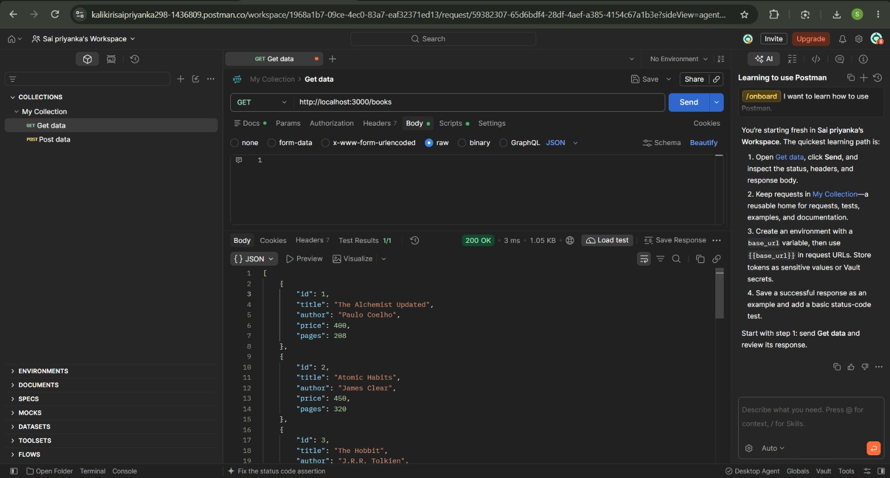
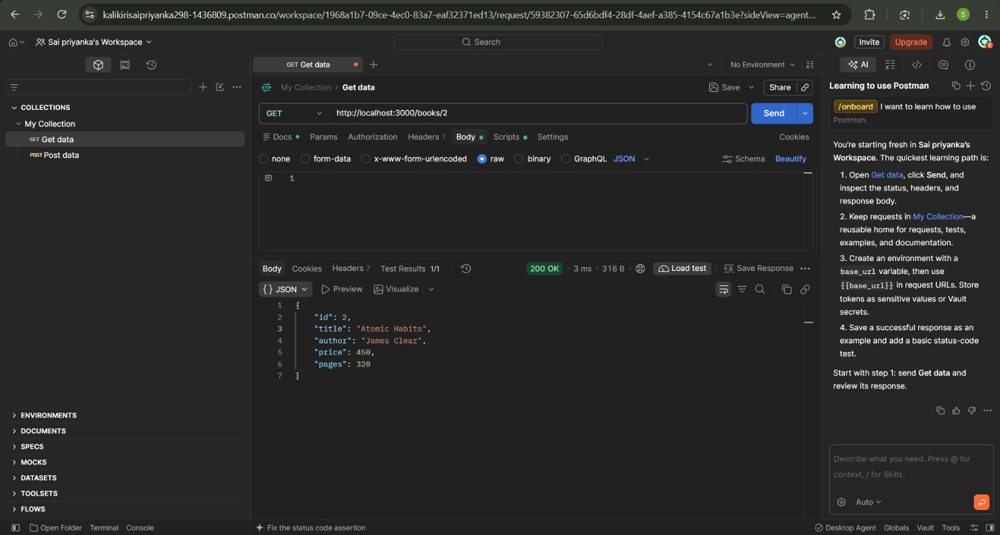
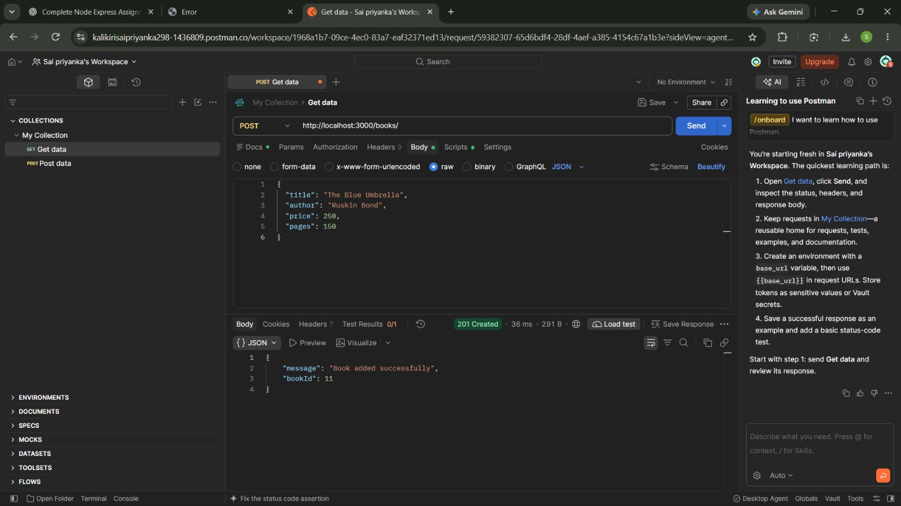
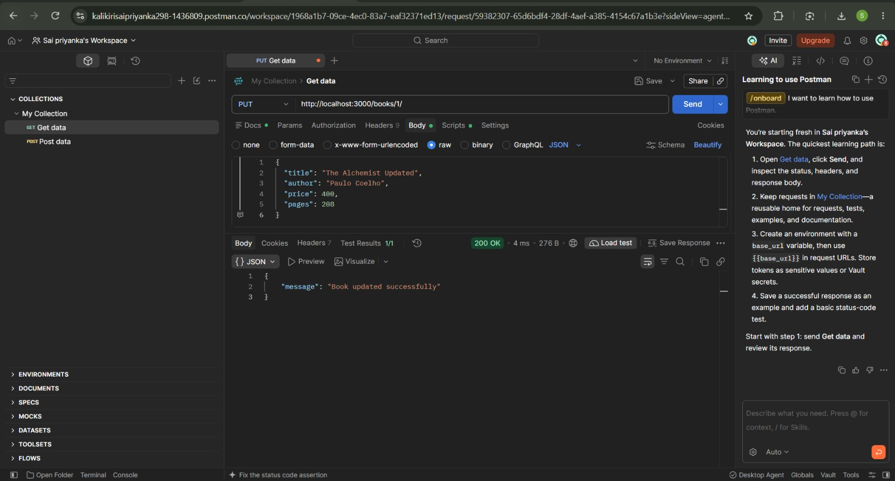
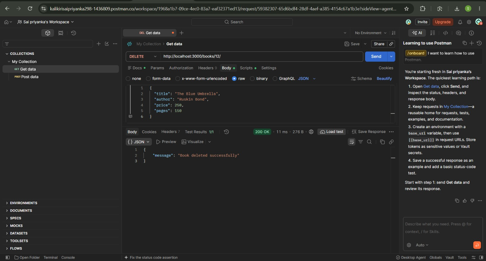

# Lab 2: SQLite Database and CRUD Routes

## Student Details

- **Name:** K. V. Sai Priyanka
- **Registration Number:** 252U1R6109
- **Section:** AIML IIB

---

## 1. Project Overview

The objective of this lab is to connect an Express.js application to an SQLite database and implement CRUD (Create, Read, Update, and Delete) operations.

This project implements a **Book Management REST API** using Node.js, Express.js, and SQLite. It allows users to retrieve all books, retrieve a specific book by ID, add new books, update existing book details, and delete books from the database.

## 2. Technologies Used

- **Node.js** — JavaScript runtime environment
- **Express.js** — Web framework for building REST APIs
- **SQLite** — Lightweight relational database
- **sqlite3** — SQLite database driver
- **sqlite** — Promise-based SQLite interface
- **Postman** — API testing tool

## 3. Project Structure

```text
lab-02/
├── app.js
├── package.json
├── package-lock.json
├── library
├── schema.sql
├── seed.sql
├── README.md
├── .gitignore
└── screenshots/
    ├── get-all-books.jpeg
    ├── get-book-by-id.jpeg
    ├── post-book.jpeg
    ├── put-book.jpeg
    └── delete-book.jpeg
```

**Note:** The database file is shown as `library` because that was the name visible in the project folder. Keep the exact filename used by your application. Make sure all screenshot filenames match the actual files in your `screenshots/` directory.

## 4. Installation and Setup

### Prerequisites

- Node.js installed
- npm installed
- Postman installed for API testing

### Step 1: Navigate to the Project Directory

```bash
cd lab-02
```

### Step 2: Install Dependencies

```bash
npm install
```

### Step 3: Start the Server

```bash
npm run dev
```

The application runs locally at:

**Base URL:** `http://localhost:3000`

Keep the server running while testing the API endpoints in Postman.

## 5. Database Details

The application uses an SQLite database to store book information.

- **Database file:** `library` (confirm the actual filename)
- **Table name:** `book`

### Table Schema

| Column | Data Type | Description |
|---|---|---|
| `id` | INTEGER | Unique identifier for each book |
| `title` | TEXT | Title of the book |
| `author` | TEXT | Name of the author |
| `price` | INTEGER | Price of the book |
| `pages` | INTEGER | Number of pages |

The `schema.sql` file defines the database table, and `seed.sql` contains the initial book records.

## 6. API Endpoints

The application implements the following five CRUD endpoints.

| No. | HTTP Method | Endpoint | Description |
|---:|---|---|---|
| 1 | GET | `/books/` | Retrieves all books |
| 2 | GET | `/books/:bookId/` | Retrieves a specific book by ID |
| 3 | POST | `/books/` | Adds a new book |
| 4 | PUT | `/books/:bookId/` | Updates an existing book |
| 5 | DELETE | `/books/:bookId/` | Deletes a book by ID |

### 6.1 GET All Books

**Method:** `GET`

**Endpoint:**

```http
GET /books/
```

**Description:** Retrieves all book records stored in the SQLite database.

**Example URL:**

`http://localhost:3000/books/`

### 6.2 GET Book by ID

**Method:** `GET`

**Endpoint:**

```http
GET /books/1/
```

**Description:** Retrieves the details of a specific book using its ID.

**Example URL:**

`http://localhost:3000/books/1/`

### 6.3 POST — Add a New Book

**Method:** `POST`

**Endpoint:**

```http
POST /books/
```

**Example URL:**

`http://localhost:3000/books/`

**Request Body:**

```json
{
  "title": "The Blue Umbrella",
  "author": "Ruskin Bond",
  "price": 250,
  "pages": 150
}
```

**Description:** Adds a new book record to the database.

### 6.4 PUT — Update a Book

**Method:** `PUT`

**Endpoint:**

```http
PUT /books/1/
```

**Example URL:**

`http://localhost:3000/books/1/`

**Request Body:**

```json
{
  "title": "The Alchemist Updated",
  "author": "Paulo Coelho",
  "price": 400,
  "pages": 208
}
```

**Description:** Updates the details of an existing book using its ID.

### 6.5 DELETE — Delete a Book

**Method:** `DELETE`

**Endpoint:**

```http
DELETE /books/11/
```

**Example URL:**

`http://localhost:3000/books/11/`

**Description:** Deletes the book with the specified ID. Book ID `11` was used for the newly added test book during testing.

## 7. Screenshots

The following screenshots demonstrate the API testing performed using Postman.

### 7.1 GET All Books

Retrieves all book records from the database.



### 7.2 GET Book by ID

Retrieves a specific book using its ID.



### 7.3 POST — Add a New Book

Adds a new book and displays the API response.



### 7.4 PUT — Update a Book

Updates an existing book and displays the success response.



### 7.5 PUT — Additional Update Test

Shows the additional update request performed during testing.


### 7.6 DELETE — Delete a Book

Deletes the test book and displays the API response.



## 8. Implementation Highlights

- Uses Express.js to define REST API endpoints.
- Connects the application to an SQLite database.
- Uses asynchronous database operations.
- Uses `await` to handle asynchronous operations.
- Uses parameterized SQL queries with `?` placeholders for user-provided values.
- Establishes the database connection before starting the server.
- Implements all five required CRUD endpoints.

## 9. Testing

The API endpoints were tested using Postman.

The following operations were tested:

1. Retrieving all books using `GET /books/`.
2. Retrieving an individual book using `GET /books/:bookId/`.
3. Adding a new book using `POST /books/`.
4. Updating an existing book using `PUT /books/:bookId/`.
5. Deleting the test book using `DELETE /books/:bookId/`.

The responses were checked to verify that the tested operations completed successfully.

## 10. Viva Questions and Answers

### 10.1 Why do we use `await` for database calls?

We use `await` to wait for an asynchronous database operation to complete before executing the next dependent operation.

In this project, `await` ensures that the database connection is established before the Express server starts. It also allows database query results to be obtained before sending the corresponding HTTP response.

### 10.2 What is SQL injection, and how do placeholders prevent it?

SQL injection is a security vulnerability in which malicious SQL code is inserted through user input to manipulate database queries.

Parameterized queries with `?` placeholders help prevent SQL injection by separating the SQL statement from user-provided values. The values are treated as data rather than executable SQL code.

**Example:**

```javascript
const query = `
  INSERT INTO book (title, author, price, pages)
  VALUES (?, ?, ?, ?)
`;

await db.run(query, [title, author, price, pages]);
```

Here, the placeholders represent the values supplied by the user. Those values are passed separately from the SQL statement.

### 10.3 When is PUT used instead of POST?

`POST` is generally used to create a new resource, while `PUT` is generally used to update or replace an existing resource at a specified URL.

In this project:

- `POST /books/` adds a new book to the database.
- `PUT /books/:bookId/` updates an existing book using its ID.

PUT is generally idempotent, meaning that repeating the same request with the same data should leave the resource in the same final state.

## 11. Problems Faced and How I Overcame Them

### 11.1 Root URL Displayed "Cannot GET /"

**Problem:** When I opened `http://localhost:3000/`, Express displayed `Cannot GET /`.

**Solution:** I tested the `/books/` endpoint and confirmed that it returned all book records successfully. I learned that the root route and the books API routes are different. A homepage route is not necessary for the required CRUD endpoints to work.

### 11.2 Postman Could Not Connect to Localhost

**Problem:** Postman displayed a Cloud Agent error when I tried to send requests to my local server.

**Solution:** I switched to Postman's Desktop Agent. After selecting the appropriate agent, I was able to send requests to my local Express server and receive successful responses.

### 11.3 Testing Database Operations

**Problem:** I needed to verify that the API could retrieve, create, update, and delete book records correctly.

**Solution:** I tested all five endpoints using Postman. I added a test book, updated an existing book, and deleted the test book. I checked the API responses to confirm that the operations completed successfully.

### 11.4 Organizing Screenshots

**Problem:** I needed to organize the API testing evidence for my lab submission.

**Solution:** I captured screenshots of the GET, POST, PUT, and DELETE requests and organized them in the `screenshots/` directory. I added Markdown image references to the README so the screenshots could be displayed on GitHub.

## 12. Deployment

**Local Development URL:** `http://localhost:3000`

The application was tested locally. A public deployment URL has not been provided.

## 13. Conclusion

This lab provided practical experience in integrating SQLite with an Express.js application and implementing REST API endpoints for CRUD operations.

It also helped me understand asynchronous database operations, parameterized SQL queries, HTTP methods, and API testing using Postman. The project demonstrates the basic operations required to manage book records in an SQLite database through an Express.js REST API.

