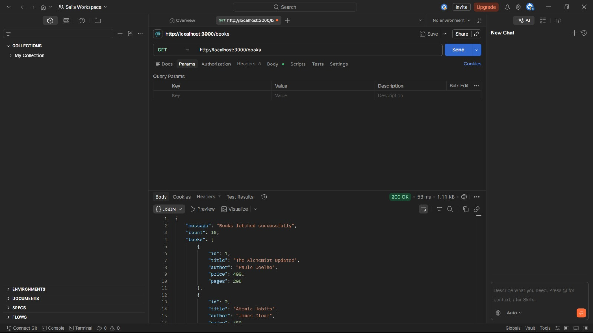
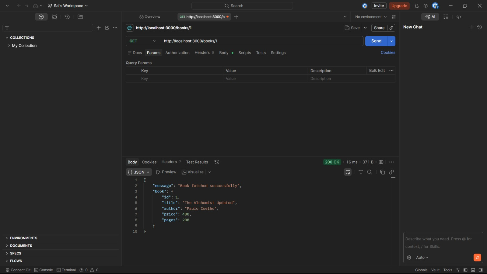
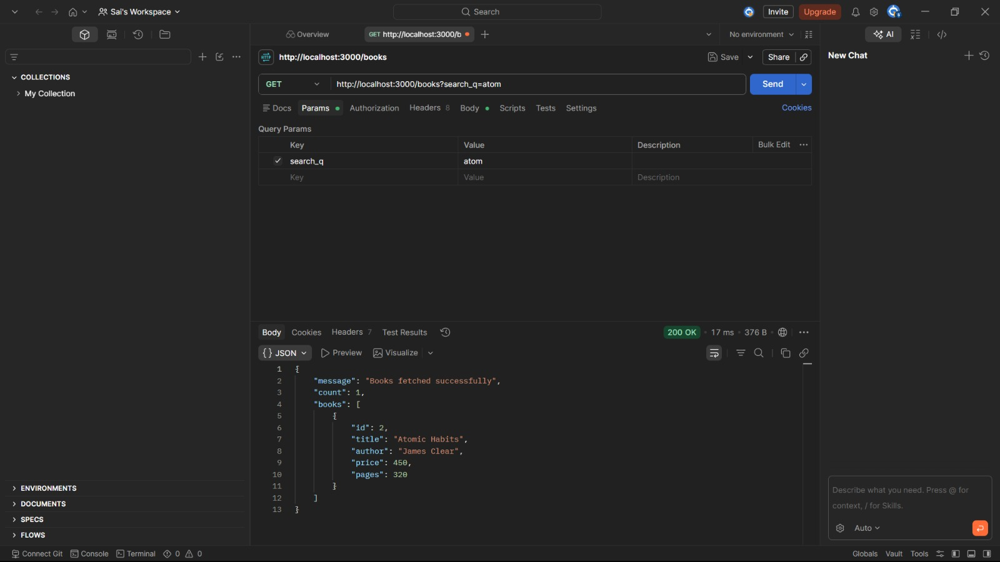
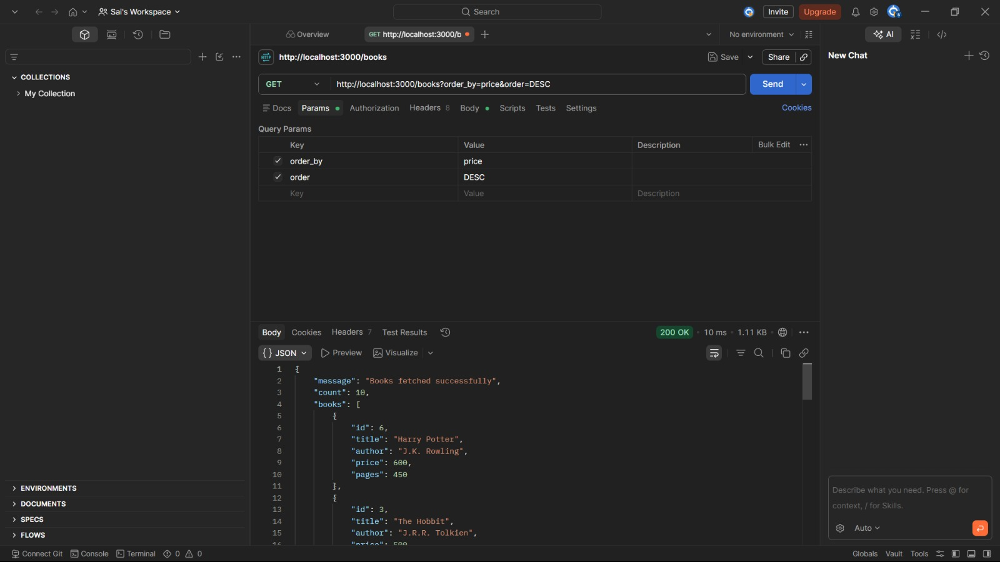
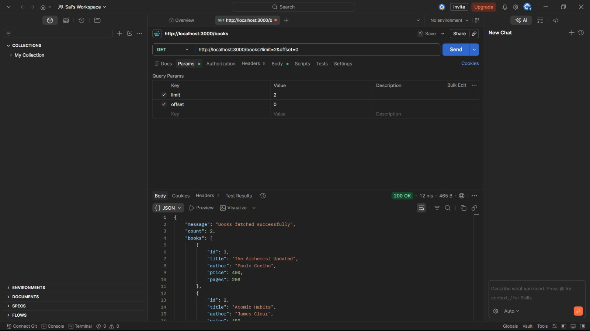
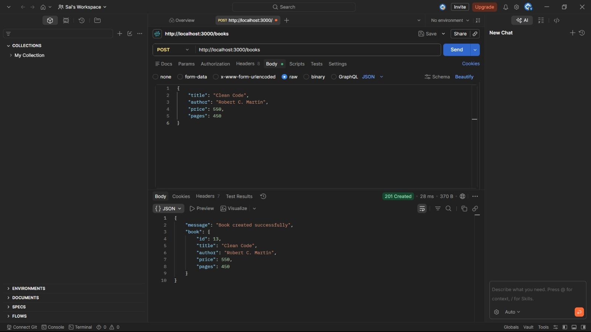
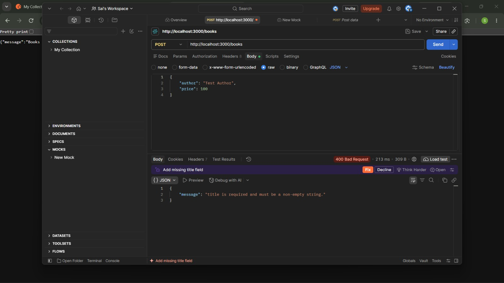
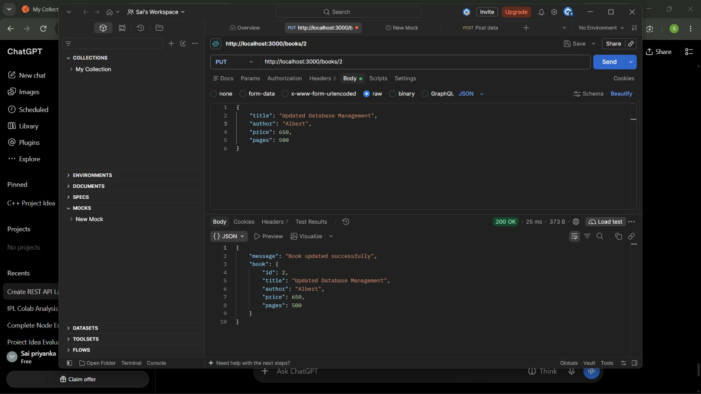
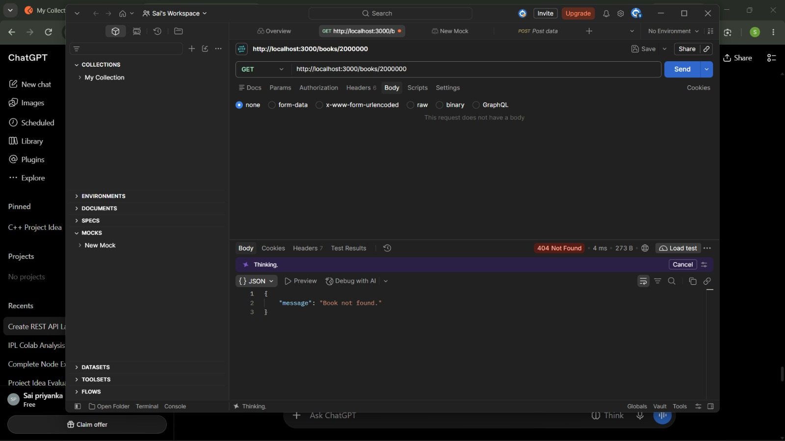
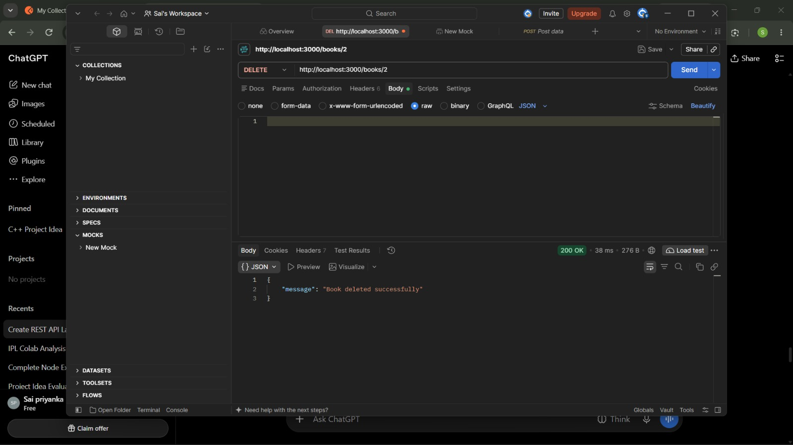

# Lab 3: REST API, query parameters, validation, debugging

## Student Details
- **Name:** K.V. Sai Priyanka
- **Registration Number:** 252U1R6109
- **Section:** AIML IIB
- **Course:** Backend Development Fundamentals
- **Lab Number:** 03

## Live Link

<https://backend-lab-03-d69y.onrender.com/>

The REST API is successfully deployed on Render and publicly accessible.

## Objective
To convert the Lab 2 book routes into a RESTful API with search, sorting, pagination, price filtering, request validation, correct HTTP status codes and consistent JSON responses.

## Technologies Used
- Node.js
- Express.js
- SQLite
- JavaScript
- Postman

## Project Structure
```text
lab-03/
├── screenshots/
├── .env.example
├── .gitignore
├── app.js
├── library.db
├── package.json
├── README.md
└── POSTMAN_TESTS.md
```

## Installation and Run
Prerequisites: Node.js and npm.

```bash
cd lab-03
npm install
npm start
```

The API runs at `http://localhost:3000`.

Optional environment variable:
- `PORT` — server port; defaults to `3000`.

For example, on Windows PowerShell:
```powershell
$env:PORT=3001
npm start
```

Do not create or commit a real `.env` file. `.env.example` contains only a safe placeholder.

## Endpoints

| Method | Path | Description | Success status |
|---|---|---|---|
| GET | `/` | Checks whether the API is running | 200 |
| GET | `/books` | Lists books; supports search, sorting, pagination and price filters | 200 |
| GET | `/books/:id` | Gets one book by ID | 200 |
| POST | `/books` | Creates a book after validating the body | 201 |
| PUT | `/books/:id` | Updates a book by ID | 200 |
| DELETE | `/books/:id` | Deletes a book by ID | 200 |

### GET /books query parameters

| Parameter | Default | Meaning |
|---|---|---|
| `search_q` | empty | Partial title search |
| `order_by` | `id` | Sort column: `id`, `title`, `author`, `price`, `pages` |
| `order` | `ASC` | Sort direction: `ASC` or `DESC` |
| `limit` | `10` | Maximum records (1–100) |
| `offset` | `0` | Number of records to skip |
| `min_price` | not applied | Minimum price, inclusive |
| `max_price` | not applied | Maximum price, inclusive |

Examples:
```text
GET http://localhost:3000/books
GET http://localhost:3000/books?search_q=atom
GET http://localhost:3000/books?order_by=price&order=DESC
GET http://localhost:3000/books?limit=5&offset=0
GET http://localhost:3000/books?min_price=300&max_price=500
GET http://localhost:3000/books?search_q=the&order_by=title&order=ASC&limit=5&offset=0&min_price=200&max_price=600
```

### POST /books body
```json
{
  "title": "Clean Code",
  "author": "Robert C. Martin",
  "price": 550,
  "pages": 450
}
```
`title`, `author` and numeric non-negative `price` are required. `pages` is optional and defaults to `0`.

### PUT /books/:id body
Send the same JSON structure as POST. The route updates the complete book record.

## Status Codes
- **200 OK:** Successful read, update or delete.
- **201 Created:** A book was created successfully.
- **400 Bad Request:** Invalid ID, missing required field or invalid query/body value.
- **404 Not Found:** Book ID or endpoint does not exist.
- **500 Internal Server Error:** Unexpected server-side failure.

All error responses use a JSON `message` field.


## 7. Postman Testing and Screenshots

### 7.1 GET All Books


### 7.2 GET Book by ID


### 7.3 Search Books


### 7.4 Sorting Books


### 7.5 Pagination


### 7.6 Price Range Filter


### 7.7 Create a New Book


### 7.8 Input Validation


### 7.9 Update a Book


### 7.10 Book Not Found


### 7.11 Delete a Book

```

## Debugging Exercise: Common Problems and Fixes
1. **EADDRINUSE:** The selected port is already occupied. Stop the other process with `Ctrl + C`, or start this server on another port using `PORT=3001` (PowerShell: `$env:PORT=3001`).
2. **Wrong import path:** Check the file name, folder name, relative path and letter casing in every `require()` statement.
3. **No such table:** Check that the database file path is correct and that the SQL table name is exactly `book`. This project opens `library.db` from the same folder as `app.js`.
4. **Missing await:** Database methods are asynchronous. Use `await` before `db.get()`, `db.all()` and `db.run()` so the code receives the completed result before sending the response.

## Notes: Problems Faced and Solutions
- Added an allowlist for `order_by` because SQL column names cannot be safely passed as ordinary query parameters.
- Used `?` placeholders and parameterised values to prevent SQL injection.
- Added validation before inserting or updating records.
- Added `await` to database operations and a central error handler for unexpected errors.
- The port can be changed through the `PORT` environment variable to avoid a port conflict.

## Git Submission
From the course repository root:
```bash
git add lab-03
git commit -m "Complete Lab 3 REST API and validation"
git push
```
Do not commit `node_modules/`, `.env`, passwords or secrets.
