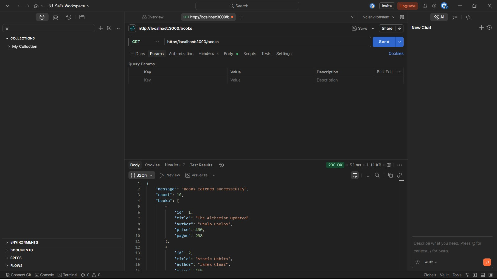
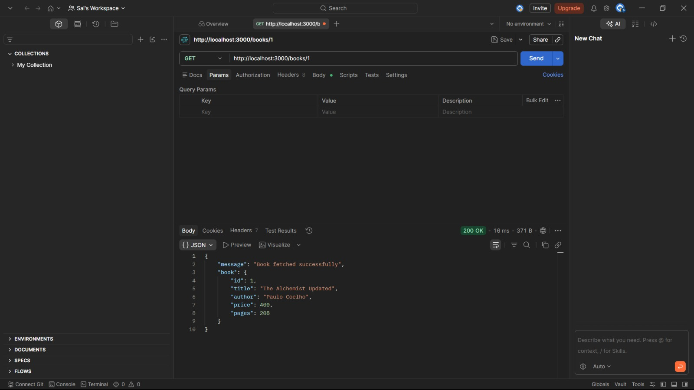
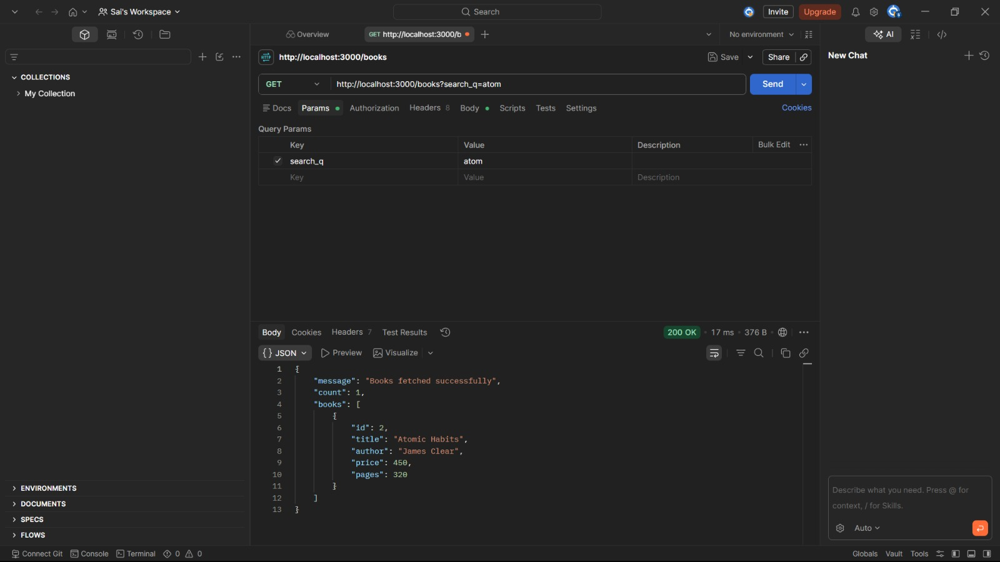
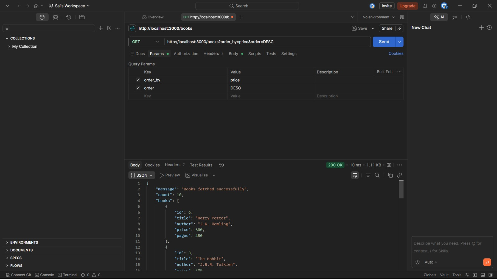
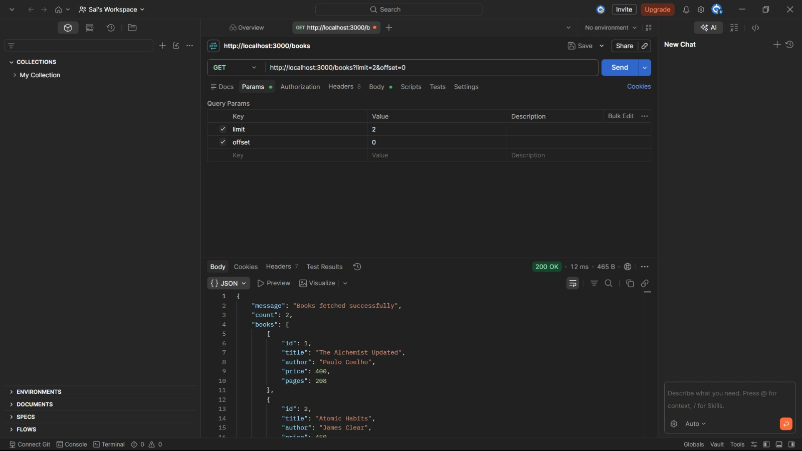
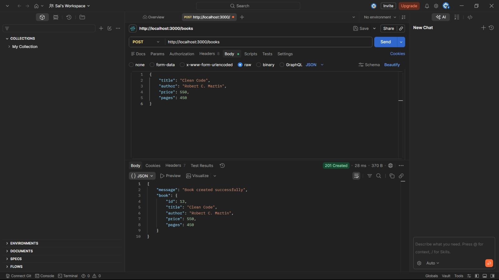
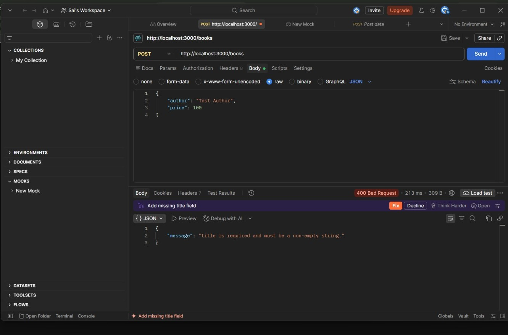
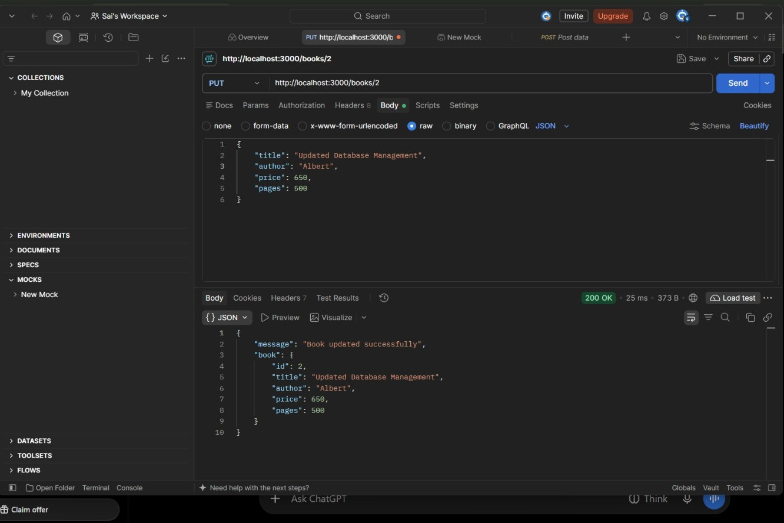
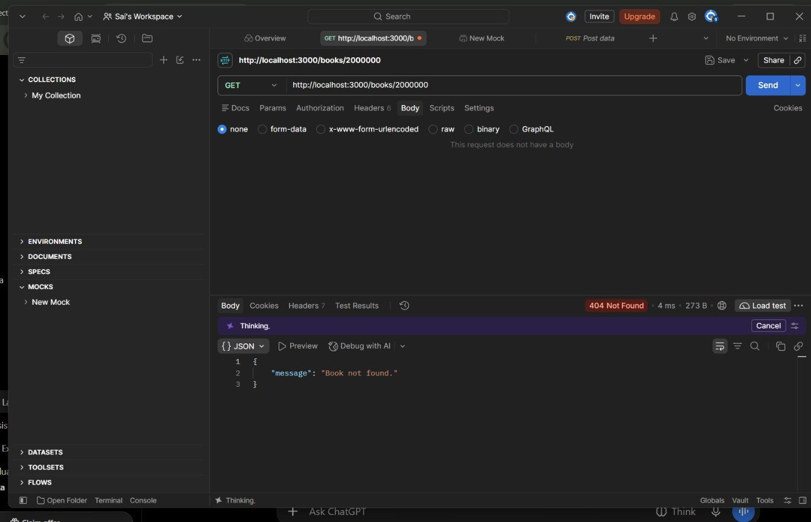
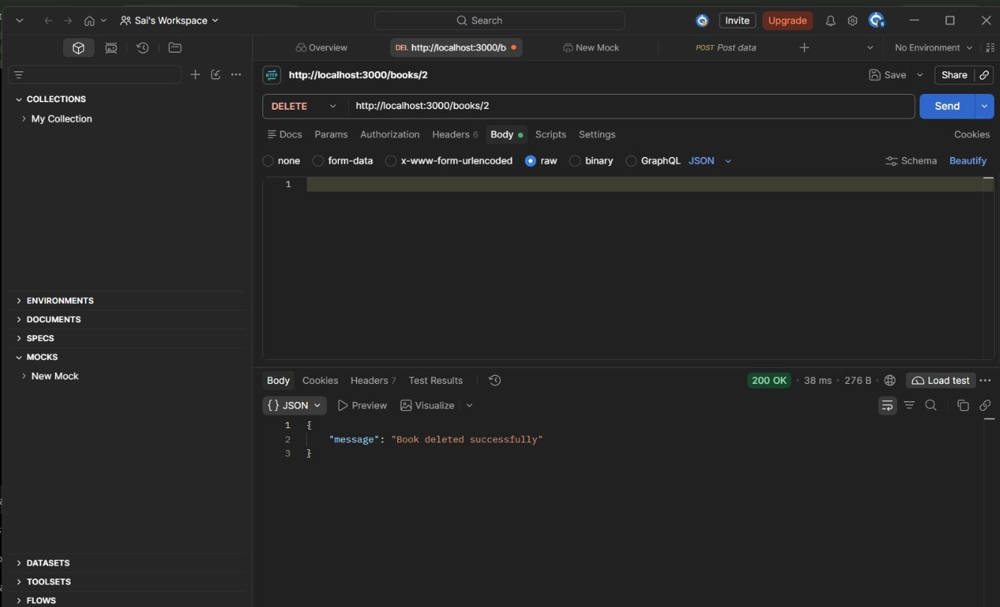

# Lab 3: REST API, Query Parameters, Validation & Debugging

## Student Details

- **Name:** Sai Priyanka
- **Registration Number:** 252U1R6109
- **Section:** AIML IIB
- **Course:** Backend Development Fundamentals
- **Lab Number:** 03

## Live Link

Not deployed yet. The project is currently running locally using Node.js and Express.js.

## 1. Objective

To develop a RESTful API using Node.js, Express.js and SQLite with search, sorting, pagination, price filtering, input validation and proper HTTP status codes. This lab also focuses on debugging common backend errors.

## 2. Technologies Used

- Node.js
- Express.js
- SQLite
- JavaScript
- Postman
- Visual Studio Code

## 3. Installation and Execution

**Prerequisites:** Node.js and npm.

1. Open the project folder in Visual Studio Code.
2. Open the terminal.
3. Install the dependencies:

```bash
npm install
```

4. Start the server:

```bash
npm start
```

5. The server runs at:

```text
http://localhost:3000
```

**Environment Variables:**

- `PORT` – Defines the server port. Default value is 3000.

## 4. API Endpoints

| HTTP Method | Endpoint | Description |
|---|---|---|
| GET | `/books` | Retrieve all books with search, sorting, pagination and price filtering. |
| GET | `/books/:id` | Retrieve a specific book using its ID. |
| POST | `/books` | Add a new book after validating the input. |
| PUT | `/books/:id` | Update an existing book using its ID. |
| DELETE | `/books/:id` | Delete a book using its ID. |

## 5. Query Parameters

The GET `/books` endpoint supports the following query parameters:

| Parameter | Description |
|---|---|
| `search_q` | Searches books using partial title matching. |
| `order_by` | Sorts books based on a selected column. |
| `order` | Specifies ASC or DESC order. |
| `limit` | Specifies the maximum number of records. |
| `offset` | Skips a specified number of records. |
| `min_price` | Filters books with a minimum price. |
| `max_price` | Filters books with a maximum price. |

## 6. Validation and HTTP Status Codes

- **200 OK:** Successful GET, PUT and DELETE requests.
- **201 Created:** Book successfully added.
- **400 Bad Request:** Missing or invalid input.
- **404 Not Found:** Requested book or endpoint does not exist.
- **500 Internal Server Error:** Unexpected server error.

All error responses return a consistent JSON message.

## 7. Postman Testing and Screenshots

The following screenshots demonstrate the API testing performed using Postman.

### 7.1 GET All Books

Retrieves all book records from the database.



### 7.2 GET Book by ID

Retrieves the details of a particular book using its ID.



### 7.3 Search Books

Searches books using partial title matching.



### 7.4 Sorting Books

Displays books according to the selected sorting order.



### 7.5 Pagination

Retrieves a limited number of books using limit and offset.



### 7.6 Price Range Filter

Filters books based on minimum and maximum prices.


### 7.7 POST – Create a New Book

Adds a new book to the database and returns 201 Created.



### 7.8 Input Validation

Checks invalid input and returns appropriate 400 Bad Request responses.



### 7.9 PUT – Update a Book

Updates the details of an existing book and returns 200 OK.



### 7.10 404 – Book Not Found

Returns a 404 Not Found response when the requested book ID does not exist.



### 7.11 DELETE – Delete a Book

Deletes an existing book successfully and returns 200 OK.



## 8. Debugging Exercises

The following common backend errors were studied and addressed:

1. **EADDRINUSE:** Occurs when the selected port is already being used. It can be solved by stopping the existing process or changing the port.
2. **Wrong Import Path:** Occurs when the required file path is incorrect. It can be fixed by checking the file name and relative path.
3. **No Such Table:** Occurs when the table name or database path is incorrect. It can be solved by checking the database connection and table name.
4. **Missing Await:** Occurs when asynchronous database operations are not properly awaited. Using `await` ensures that the operation completes before processing its result.

## 9. Security and Best Practices

- Used parameterised SQL queries to prevent SQL injection.
- Validated user input before database operations.
- Used appropriate HTTP status codes.
- Maintained consistent JSON response messages.
- Added `.gitignore` to avoid committing unnecessary files.
- Avoided committing `.env` files and `node_modules`.

## 10. Conclusion

This lab provided practical experience in developing RESTful APIs using Node.js, Express.js and SQLite. It helped in understanding CRUD operations, query parameters, searching, sorting, pagination, price filtering and input validation. Postman was used to test successful and unsuccessful API requests. The lab also improved debugging skills and understanding of HTTP status codes.