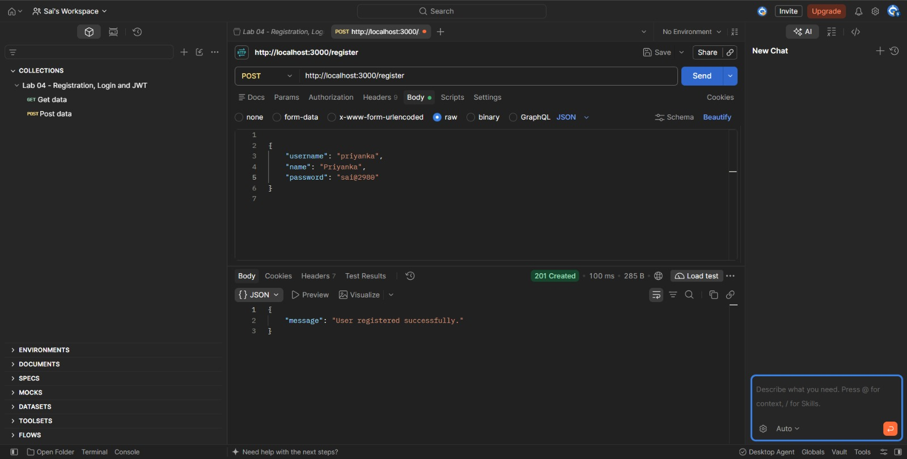
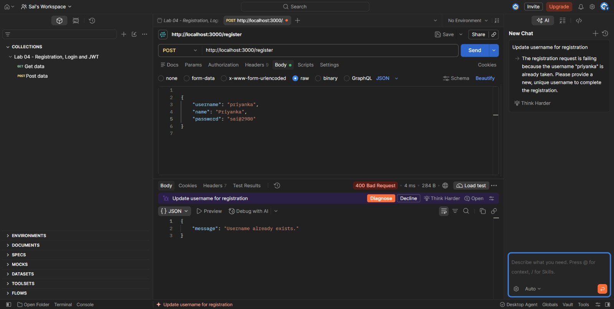
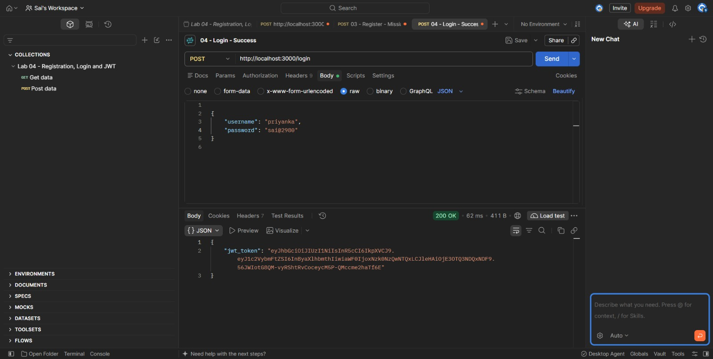
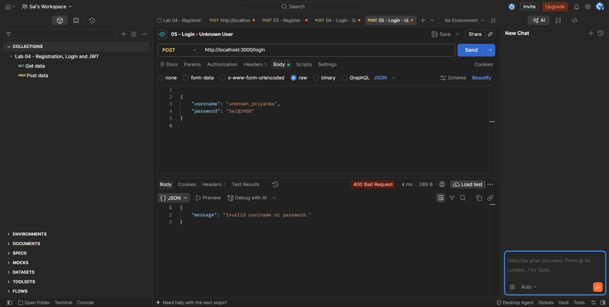
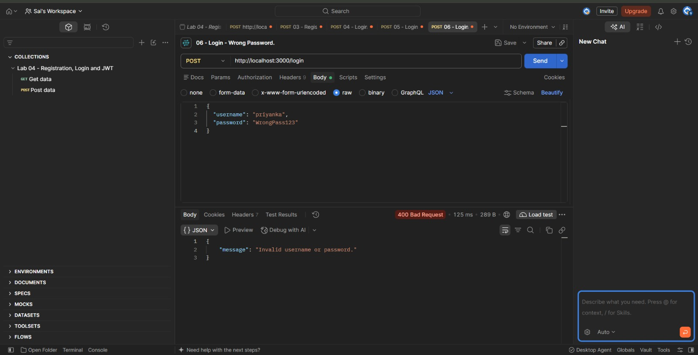
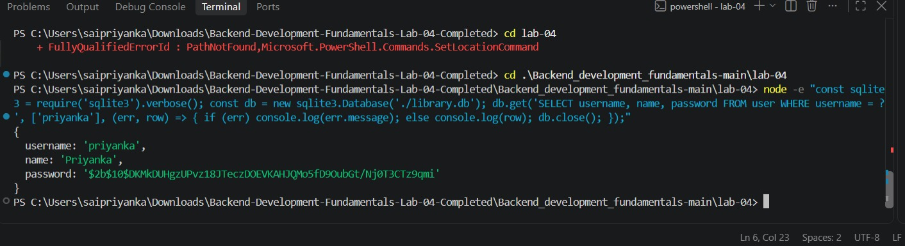
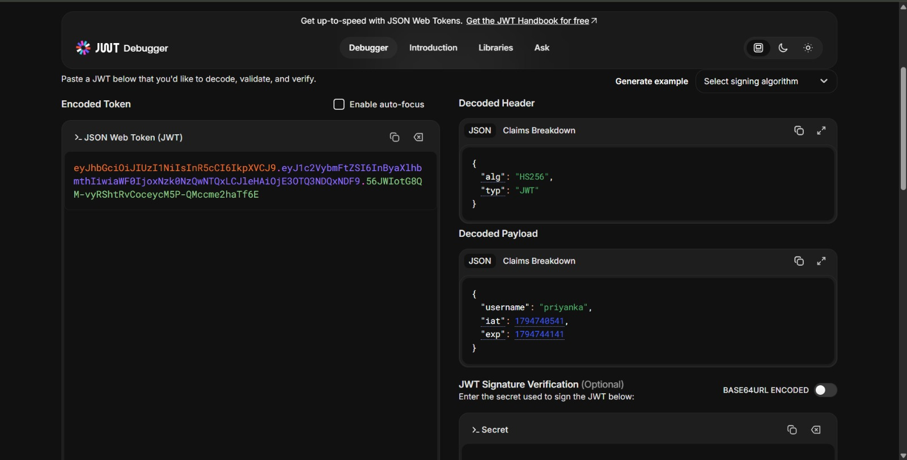

# Lab 4: Registration, Login and JWT

## Student Details

- **Name:** Priyanka
- **Registration Number:** 252U1R6109
- **Section:** AIML 2B
- **Course:** Backend Development Fundamentals
- **Lab Number:** 04

## Live Link

Not deployed yet. The application is running locally at `http://localhost:3000`.

## Objective

To implement user registration and login functionality in the existing Lab 3 Express and SQLite project. Passwords are hashed using bcrypt before being stored in the database. After successful login, the application generates a signed JSON Web Token (JWT).

## Technologies Used

- Node.js
- Express.js
- SQLite
- bcrypt
- jsonwebtoken
- Postman
- Visual Studio Code

## Project Structure

```text
lab-04/
├── screenshots/
│   ├── register-success.jpeg
│   ├── register-duplicate.jpeg
│   ├── login-success.jpeg
│   ├── login-unknown-user.jpeg
│   ├── login-wrong-password.jpeg
│   ├── database-password-hash.jpeg
│   └── jwt-decode.jpeg
├── .env.example
├── .gitignore
├── app.js
├── library.db
├── package.json
├── package-lock.json
├── POSTMAN_TESTS.md
└── README.md
```

## Installation and Execution

### Prerequisites

- Node.js installed
- npm installed
- Visual Studio Code

### Installation

Open the terminal inside the `lab-04` folder and execute:

```bash
npm install
```

### Start the Server

```bash
npm start
```

The server runs at:

```text
http://localhost:3000
```

The application uses `library.db` as its SQLite database. The `user` table is created automatically when the application starts. The existing Lab 3 book table and routes are retained.

### Port Configuration

**PowerShell:**

```powershell
$env:PORT=3001
npm start
```

**macOS/Linux:**

```bash
PORT=3001 npm start
```

## Database Details

The application uses SQLite to store registered user information.

The `user` table contains the following columns:

| Column | Description |
|---|---|
| username | Unique username of the registered user |
| name | Name of the registered user |
| password | Bcrypt-hashed password |

### Registered User Used for Testing

- **Username:** `priyanka`
- **Name:** `Priyanka`
- **Password:** Stored as a bcrypt hash, not in plain text.

Bcrypt uses 10 salt rounds to hash passwords before storing them in the database.

## API Endpoints

| Method | Endpoint | Description | Success Status |
|---|---|---|---|
| POST | `/register` | Registers a new user | 201 |
| POST | `/login` | Authenticates a user and generates a JWT | 200 |
| GET | `/` | Returns the API health message | 200 |
| GET | `/books` | Retrieves books | 200 |
| GET | `/books/:id` | Retrieves a book by ID | 200 |
| POST | `/books` | Adds a new book | 201 |
| PUT | `/books/:id` | Updates a book | 200 |
| DELETE | `/books/:id` | Deletes a book | 200 |

## Registration API

**Method:** POST

**URL:**

```text
http://localhost:3000/register
```

**Request Body (raw JSON):**

```json
{
  "username": "priyanka",
  "name": "Priyanka",
  "password": "sai@2980"
}
```

**Successful Response:**

Status: `201 Created`

```json
{
  "message": "User registered successfully."
}
```

If the username already exists, the API returns `400 Bad Request`.

## Login API

**Method:** POST

**URL:**

```text
http://localhost:3000/login
```

**Request Body (raw JSON):**

```json
{
  "username": "priyanka",
  "password": "YourStrongPassword123"
}
```

**Successful Response:**

Status: `200 OK`

```json
{
  "jwt_token": "<signed-token>"
}
```

The JWT payload contains the username and does not contain the password or password hash. The token expires after one hour.

Invalid usernames and incorrect passwords return `400 Bad Request`.

## Postman Testing

The registration and login endpoints were tested using Postman.

The following test cases were performed:

1. Successful user registration.
2. Duplicate username registration.
3. Registration with missing fields.
4. Successful login with valid credentials.
5. Login with an unknown username.
6. Login with an incorrect password.
7. Login with missing fields.

## Screenshots

### 1. Successful Registration



### 2. Duplicate Registration



### 3. Successful Login



### 4. Login with Unknown Username



### 5. Login with Incorrect Password



### 6. Database Password Hash Verification



### 7. JWT Decoding



## JWT Explanation

A JSON Web Token consists of three parts:

1. **Header:** Contains the token type (`JWT`) and signing algorithm (`HS256`).
2. **Payload:** Contains the username and token timestamps.
3. **Signature:** Used to verify that the header and payload were signed using the server's secret key.

The generated JWT was decoded using [jwt.io](https://jwt.io/).

The decoded payload was checked to confirm that:

- The username is `priyanka`.
- The token contains an issued-at timestamp (`iat`).
- The token contains an expiration timestamp (`exp`).
- The password is not included in the payload.

A JWT is signed, not encrypted. Sensitive information should never be placed in its payload.

## Viva Preparation

**1. Why is POST used for login?**

POST sends login credentials in the request body instead of exposing them in the URL.

**2. What is the difference between hashing and encryption?**

Hashing is a one-way process, whereas encryption is reversible using a key. Bcrypt is used for password hashing.

**3. What does `jwt.sign()` require?**

It requires a payload, a secret key and optional signing options such as token expiry.

**4. What should never be included in a JWT payload?**

Passwords, password hashes, API keys and other sensitive information.

## Problems Faced and Solutions

- Used `bcrypt.hash()` with 10 salt rounds to securely hash passwords.
- Used `bcrypt.compare()` to verify passwords during login.
- Used parameterized SQL queries to prevent SQL injection.
- Checked for duplicate usernames before registration.
- Used `jwt.sign()` to generate JWT tokens after successful authentication.
- Included only the username in the JWT payload.
- Used SQLite to store registered user information.
- Preserved the existing Lab 3 book routes and database functionality.
- Tested valid and invalid registration and login requests using Postman.

## GitHub Submission

The Lab 4 project is maintained inside the `lab-04/` folder of the course repository.

From the course repository root, execute:

```bash
git add lab-04
git commit -m "Complete Lab 4 registration login and JWT"
git push
```

**Important:** Do not commit `node_modules/`, `.env`, actual passwords or sensitive signing secrets.